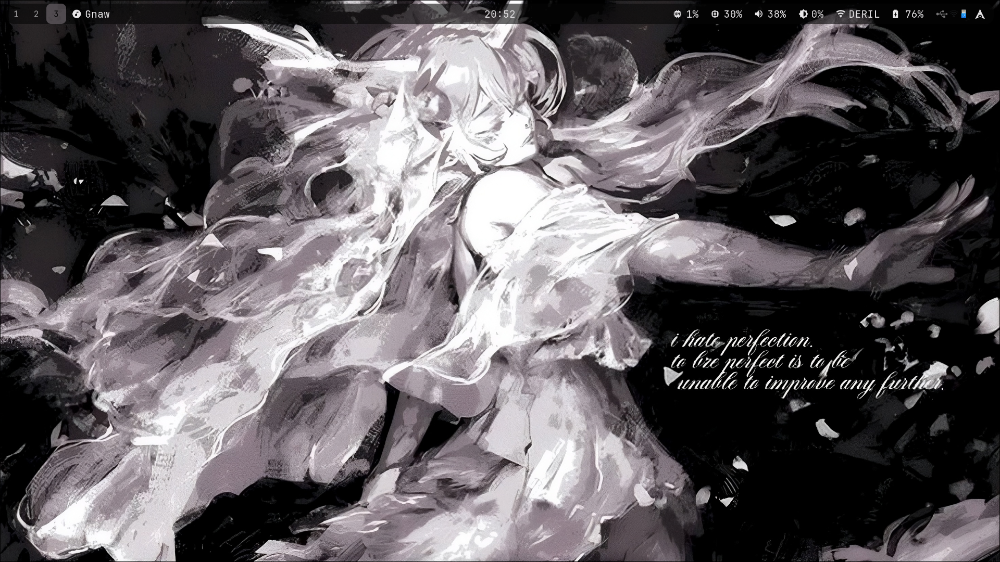
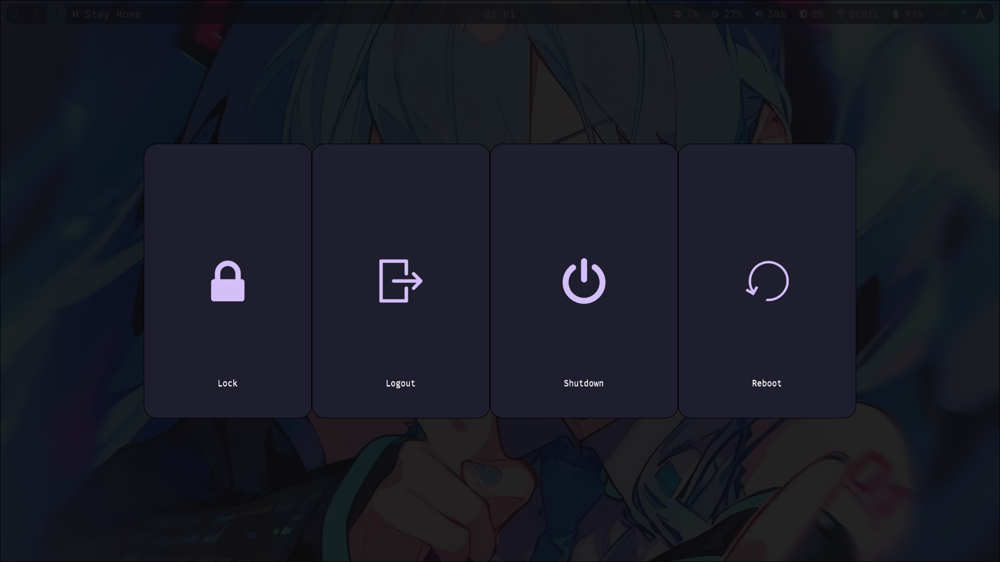
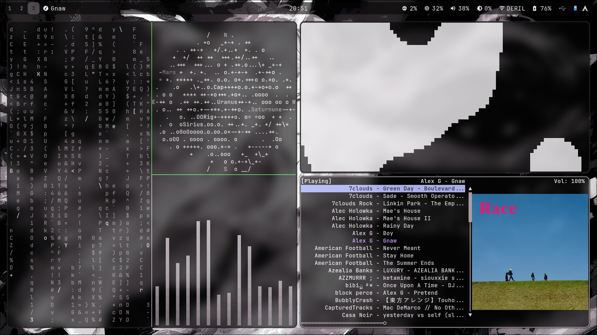
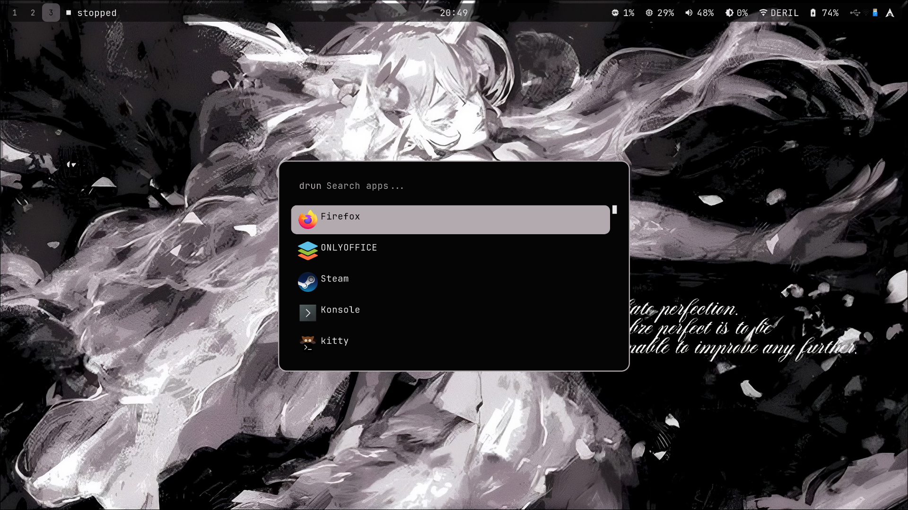
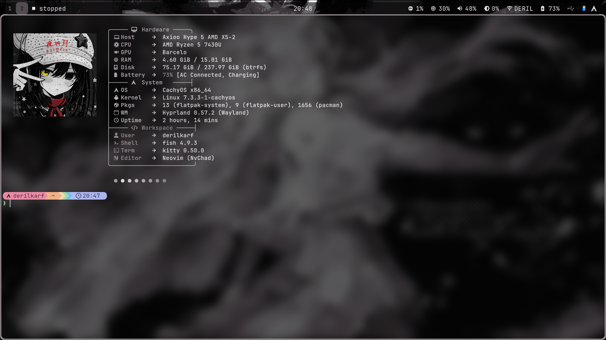

# Dotfiles

My Hyprland rice on CachyOS, kept here as a backup and so I can reinstall it fast.

| Desktop | |
|---|---|
|  |  |

| Showcase | |
|---|---|
| ![]https://github.com/user-attachments/assets/c3c4a974-0e1a-4d1a-84a7-0f7a01dd392a
 |

## Screenshots

| Terminal | Rofi launcher | Fastfetch
|---|---|---|
|  |  |  |

## What's inside

| Folder | Program |
|---|---|
| `fastfetch` | System Information |
| `hypr` | Hyprland (window manager) |
| `kitty` | Terminal |
| `mako` | Notifications |
| `rmpc` | Music player (MPD client) |
| `rofi` | App launcher |
| `scripts` | Custom Command |
| `starship` | Shell prompt |
| `waybar` | Status bar |
| `wlogout` | Logout menu |

## Install

```bash
git clone https://github.com/Derilkarf/hyprland-rice.git ~/hyprland-rice
cd ~/dotfiles
sudo pacman -S stow hyprland waybar rofi kitty mako starship wlogout mpd rmpc
stow hypr waybar rofi kitty mako rmpc starship wlogout
```

`stow` links each folder into `~/.config`. Back up your existing configs first, or stow will refuse to overwrite them.

## Notes

- Made for Arch-based systems (CachyOS).
- Wallpapers and fonts are not included yet.
